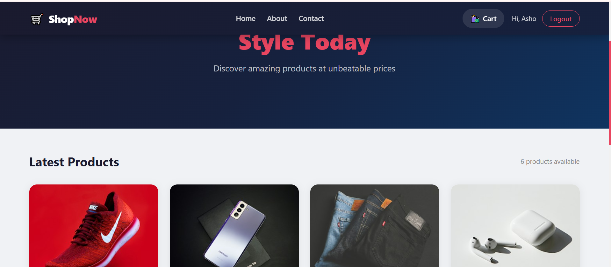

# ShopNow — E-Commerce Store

Full-stack e-commerce app built with the MERN stack: product browsing, shopping cart, JWT authentication and order placement with stock updates.



## Features

- Browse products and view product details
- User registration and login with JWT authentication
- Shopping cart with quantity controls
- Checkout and order placement
- Order history for the logged-in user
- Stock management: inventory decreases after purchase
- Admin-only API routes for creating, updating and deleting products
- About and Contact pages

## Tech Stack

| Layer | Technologies |
|---|---|
| Frontend | React (Vite), React Router DOM, Axios, Context API |
| Backend | Node.js, Express.js, Mongoose |
| Database | MongoDB Atlas |
| Auth | JWT, bcryptjs |

## Project Structure

```
CodeAlpha_EcommerceStore/
├── backend/
│   ├── src/
│   │   ├── config/        # Database connection
│   │   ├── models/        # user, product, order
│   │   ├── controllers/   # auth, product, order
│   │   ├── routes/        # auth, product, order
│   │   └── middleware/    # auth and admin guards
│   ├── package.json
│   └── server.js
├── frontend/
│   └── src/
│       ├── components/    # Navbar, ProductCard
│       ├── pages/         # Home, Product, Cart, Checkout, Order, Login, Register, About, Contact
│       ├── context/       # AuthContext, CartContext
│       └── services/      # api.js
├── .gitignore
├── demo.png
└── README.md
```

## Run Locally

**Requirements:** Node.js 18 or newer and a MongoDB Atlas connection string.

```bash
# 1. Clone the repository
git clone https://github.com/ash-1212/CodeAlpha_EcommerceStore.git
cd CodeAlpha_EcommerceStore
```

**Backend** (first terminal)

```bash
cd backend
npm install
```

Create a `.env` file inside `backend/`:

```
PORT=5000
MONGO_URI=your_mongodb_atlas_connection_string
JWT_SECRET=your_jwt_secret_key
```

```bash
npm run dev
```

**Frontend** (second terminal)

```bash
cd frontend
npm install
npm run dev
```

Open the link shown in the terminal (usually http://localhost:5173). The frontend expects the API at `http://localhost:5000/api`.

## Environment Variables

| Variable | Description |
|---|---|
| PORT | Port for the backend server |
| MONGO_URI | MongoDB Atlas connection string |
| JWT_SECRET | Secret key used to sign JWT tokens |

Never commit your `.env` file.

## API Endpoints

### Auth

| Method | Endpoint | Access | Description |
|---|---|---|---|
| POST | /api/auth/register | Public | Register |
| POST | /api/auth/login | Public | Login |
| GET | /api/auth/profile | Logged in | Get user profile |

### Products

| Method | Endpoint | Access | Description |
|---|---|---|---|
| GET | /api/products | Public | List products |
| GET | /api/products/:id | Public | Get one product |
| POST | /api/products | Admin | Create product |
| PUT | /api/products/:id | Admin | Update product |
| DELETE | /api/products/:id | Admin | Delete product |

### Orders

| Method | Endpoint | Access | Description |
|---|---|---|---|
| POST | /api/orders | Logged in | Place an order |
| GET | /api/orders/myorders | Logged in | Get my orders |
| GET | /api/orders/:id | Logged in | Get one order |
| GET | /api/orders | Admin | Get all orders |

## Notes

- Products are managed through the admin API routes. There is no admin dashboard in the interface yet.
- The project runs locally and has not been deployed.

## Future Improvements

- Admin dashboard for managing products and orders
- Product reviews and ratings in the interface
- Online payment integration
- Deployment (Render and Vercel)

## Author

**Ayesha Nazish**
Built during the CodeAlpha Full Stack Development Internship (Task 1).
[GitHub](https://github.com/ash-1212) · [LinkedIn](https://www.linkedin.com/in/ayeshanazish-452048274)